# 💓 Heart Monitoring System in IoT Environment

### *When Your Heart Speaks, Our Device Responds*


A low-cost, portable **IoT heart monitoring system** built on a **Raspberry Pi 4**. It records a live **ECG**, measures **pulse rate**, and uses a **fingerprint sensor** to identify the user, then sends the readings to a **Firebase Realtime Database** and shows everything on a **web dashboard**.

> Developed at **Bangladesh Army University of Engineering & Technology (BAUET)**, Qadirabad Cantonment, Natore, Bangladesh.

<p align="center">
  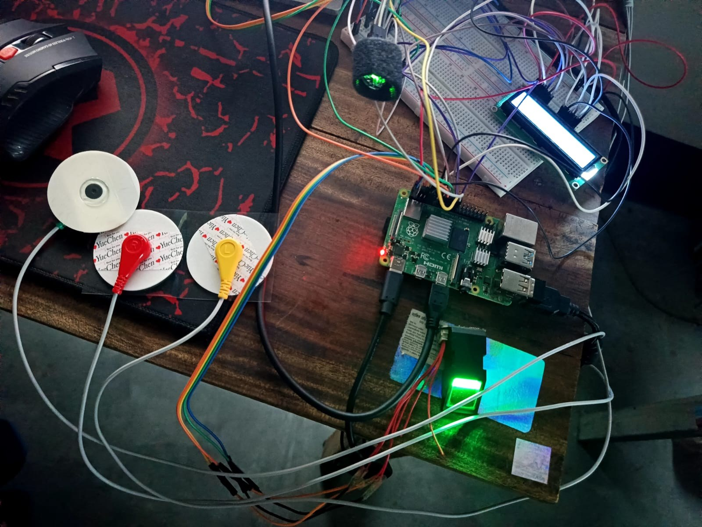
  <br><em>The complete hardware prototype: Raspberry Pi 4, ECG electrodes, fingerprint sensor, pulse sensor and 16×2 LCD.</em>
</p>

---

## 📑 Table of Contents

1. [Overview](#-overview)
2. [Objectives](#-objectives)
3. [Key Features](#-key-features)
4. [Project Status](#-project-status)
5. [Hardware](#-hardware)
6. [System Design](#-system-design)
7. [Software](#-software)
8. [Web Interface](#-web-interface)
9. [Installation & Setup](#-installation--setup)
10. [How to Use](#-how-to-use)
11. [Challenges](#-challenges)
12. [Future Scope](#-future-scope)
13. [Team](#-team)
14. [Disclaimer](#-disclaimer)

---

## 🔎 Overview

Heart attacks can happen without warning, and quick detection is critical. This project uses IoT technology to monitor a person's heart in real time and store the data in the cloud, so it can be reviewed remotely and acted on early.

The system combines three kinds of sensing with a web application:

| Capability | What it does |
|---|---|
| **ECG monitoring** | Captures the heart's electrical signal through skin electrodes, filters it and displays a live waveform |
| **Pulse measurement** | Estimates heart rate (BPM) from a pulse sensor and shows it on the LCD and the dashboard |
| **Fingerprint identification** | Enrolls, verifies and deletes fingerprints so that monitoring is tied to a person |
| **Cloud + Web dashboard** | Firebase handles user accounts and stores all readings; a Flask web app controls the device |

📄 The full project poster is available here: [`docs/project_poster.pdf`](docs/project_poster.pdf)

---

## 🎯 Objectives

- Monitor heart rate using IoT technology to detect abnormal heart patterns and send alerts to a consultant doctor or caregiver.
- Enable remote health monitoring through a website, reducing diagnosis delay after a heart attack.
- Provide a **compact, portable and affordable** system with better security through fingerprint-based identification.

---

## ✨ Key Features

- 🫀 **Live ECG** with band-pass filtering (0.5–40 Hz) and a real-time plot
- 💗 **Pulse check** with automatic peak detection and BPM calculation
- 🔐 **Fingerprint enroll / verify / delete** using an optical fingerprint sensor
- 🖥️ **Local feedback on a 16×2 LCD** (status messages and BPM)
- ☁️ **Cloud sync** of ECG, pulse and fingerprint events to Firebase Realtime Database
- 👤 **User accounts** (sign up / login) with Firebase Authentication
- 🌐 **Responsive web dashboard** built with Flask, HTML and CSS
- 🖼️ **ECG snapshots** saved as images in the `ecg_images/` folder

---

## 📌 Project Status

| Module | Status |
|---|---|
| Hardware assembly (Pi 4, ECG, pulse sensor, fingerprint sensor, ADC, LCD) | ✅ Implemented |
| ECG acquisition, filtering and live plotting | ✅ Implemented |
| Pulse rate measurement (BPM) | ✅ Implemented |
| Fingerprint enroll / verify / delete | ✅ Implemented |
| Firebase Authentication (sign up / login) | ✅ Implemented |
| Firebase Realtime Database storage | ✅ Implemented |
| Flask web dashboard | ✅ Implemented |
| AI / Machine-learning analysis and threshold-based alerts | 🔜 Planned (see [Future Scope](#-future-scope)) |
| Doctor / caregiver notifications | 🔜 Planned |

---

## 🔧 Hardware

### Components

| # | Component | Role in the system |
|---|---|---|
| 1 | **Raspberry Pi 4** | Main controller; runs the web server, reads sensors and syncs with Firebase |
| 2 | **ECG sensor** with 3 snap electrodes (R, L, reference) | Picks up the heart's electrical activity from the skin |
| 3 | **Pulse sensor** | Measures the pulse waveform used to calculate BPM |
| 4 | **Fingerprint sensor** (UART) | Enrolls and verifies users |
| 5 | **MCP3008 ADC** (10-bit, 8-channel, SPI) | Converts the analog ECG / pulse signals for the Raspberry Pi, which has no analog inputs |
| 6 | **16×2 character LCD** | Shows messages such as *Verifying…*, *Matched!* and *Pulse 72* |
| 7 | **Breadboard and jumper wires** | Prototyping connections |


### Wiring (as configured in the code)

All GPIO numbers use the **BCM** numbering scheme.

| Module | Interface | Pi connection |
|---|---|---|
| **16×2 LCD** (4-bit mode) | GPIO | RS → GPIO 25 · E → GPIO 24 · D4 → GPIO 23 · D5 → GPIO 17 · D6 → GPIO 18 · D7 → GPIO 22 · Backlight → GPIO 2 |
| **Fingerprint sensor** | UART | `/dev/ttyS0` at **57600 baud** (Pi TXD0 / RXD0, GPIO 14 / 15) |
| **MCP3008 ADC** | SPI0 (CE0) | SCLK → GPIO 11 · MOSI → GPIO 10 · MISO → GPIO 9 · CS → GPIO 8 · bus speed 1.35 MHz |
| **ECG sensor output** | Analog → MCP3008 | Channel 0 (`read_adc(0)`) |
| **Pulse sensor output** | Analog → MCP3008 | Channel set by `PULSE_CHANNEL` in `system_core.py` |

> 💡 The pulse sensor channel is a single constant (`PULSE_CHANNEL`) at the top of the pulse routine. Set it to match the MCP3008 input your pulse sensor is wired to.

A circuit schematic was drawn in **Cirkit Designer** and is included in the poster (`docs/project_poster.pdf`).

---

## 🧭 System Design

### Methodology

Data flows from the sensing device, is cleaned by a noise-removal stage, and reaches the website. Readings are stored in the database, and the architecture includes an AI / ML stage that can raise notifications back to the website.

<p align="center">
  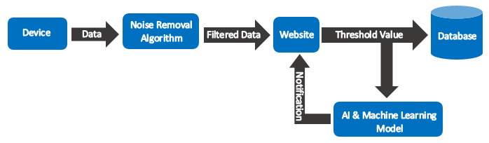
</p>

### Data Flow Diagram

A user signs up or logs in (both talk to the database), reaches the dashboard, and from there triggers the ECG, pulse check and fingerprint modules, whose results are written to the database.

<p align="center">
  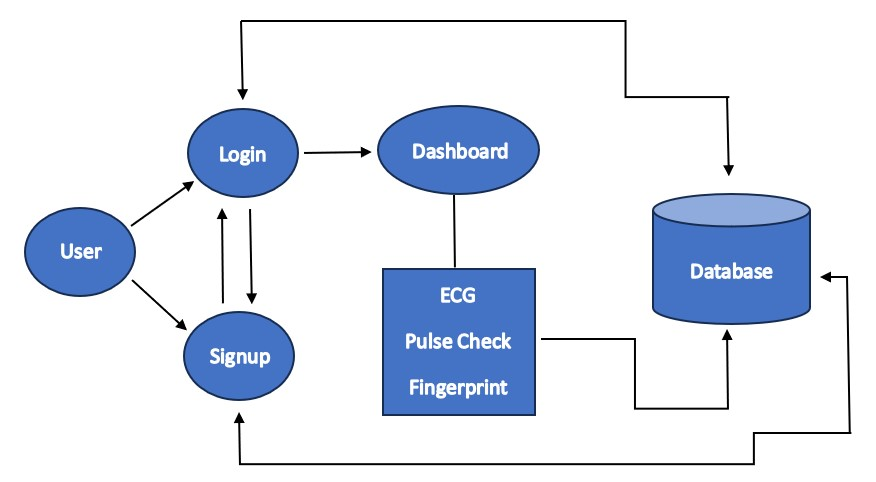
</p>

### Use Case Diagram

Inside the Raspberry Pi system boundary there are four use cases: **ECG**, **Pulse Rate**, **Fingerprint** and **Delete Fingerprint**. They are available to both the **Admin** and the **Users**.

<p align="center">
  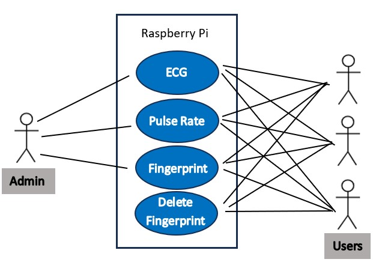
</p>

### Screen-Flow / ER Diagram

The screen flow runs from **Sign-Up** (email, password) to **Login** to the **Dashboard** (ECG, Pulse Check, Fingerprint, Delete Fingerprint, Exit). Dashboard actions write to the **Database**.

<p align="center">
  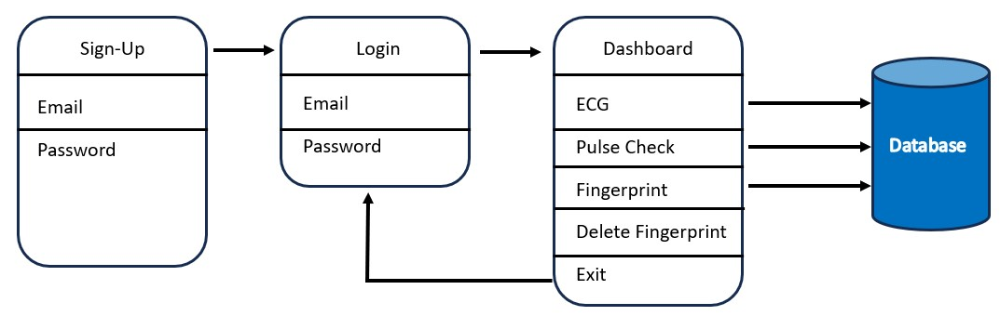
</p>

---

## 💻 Software

### Tech Stack

| Layer | Technology |
|---|---|
| Language | Python 3 |
| Web framework | Flask, Jinja2 templates, HTML / CSS / JavaScript (`fetch`) |
| Cloud | Firebase Authentication + Realtime Database (via `pyrebase4`) |
| Signal processing | NumPy, SciPy (`butter`, `filtfilt`, `find_peaks`) |
| Plotting | Matplotlib (Tkinter backend for the live ECG window) |
| Hardware access | `RPi.GPIO`, `spidev`, `pyserial`, `adafruit-circuitpython-fingerprint`, `RPLCD` |

### Project Structure

```
.
├── README.md
├── docs/
│   ├── project_poster.pdf
│   └── images/                 # hardware photo, diagrams, screenshots
└── Heart-Monitoring-System/
    ├── app.py                  # Flask routes: login, signup, dashboard, /run/<cmd>
    ├── firebase_client.py      # Firebase config, auth, and database push helpers
    ├── system_core.py          # Hardware control, ECG / pulse processing, fingerprint logic
    ├── templates/
    │   ├── login.html
    │   ├── signup.html
    │   └── dashboard.html
    ├── static/
    │   └── style.css
    └── ecg_images/             # ECG snapshots saved after each recording
```

### How the Modules Work

**`app.py`**: the Flask application.

| Route | Purpose |
|---|---|
| `/` | Redirects to the login page |
| `/login`, `/signup` | Authenticate or register through Firebase |
| `/dashboard` | Main control panel (requires login) |
| `/run/<cmd>` | Runs a hardware command: `enroll`, `verify`, `pulse` or `delete` |
| `/logout` | Ends the session |

**`firebase_client.py`**: wraps Firebase. It provides sign-up and login helpers and functions to push fingerprint events, ECG batches and pulse readings. Each user's record is stored under their email (with `.` replaced by `_`).

**`system_core.py`**: talks to the hardware:

- **ECG**: reads the ADC, applies a 4th-order Butterworth band-pass filter (0.5–40 Hz) plus a 0.5 Hz high-pass stage with zero-phase filtering (`filtfilt`), draws the live plot, and after the 30-second window saves a snapshot image and uploads the filtered samples.
- **Pulse**: samples for 10 seconds, removes the DC offset, normalizes, band-pass filters at 0.7–3.0 Hz (42–180 BPM), detects peaks with a minimum spacing of 0.4 s and computes BPM as `60 / mean(peak interval)`. The result is shown on the LCD and sent to Firebase.
- **Fingerprint**: two-scan enrollment, template creation and storage, search-based verification, and template deletion. Verification success starts the ECG monitor.

### Firebase Data Structure

```json
{
  "devices": {
    "raspi4-001": {
      "ecg": {
        "<user_email_with_underscores>": { "fs": 100, "samples": [ ... ], "timestamp": 1762952497.44 }
      },
      "fingerprints": {
        "<user_email_with_underscores>": { "event": "enroll", "finger_id": 1, "result": true, "timestamp": 1762950958.32 }
      },
      "pulses": {
        "<user_email_with_underscores>": { "bpm": 99, "status": "Normal", "timestamp": 1762952020.62 }
      }
    }
  }
}
```

<p align="center">
  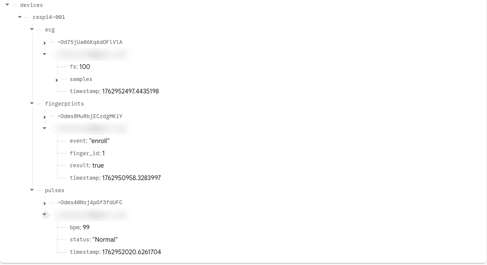
  <br><em>Live data in the Firebase Realtime Database.</em>
</p>

---

## 🌐 Web Interface

<table>
  <tr>
    <td align="center">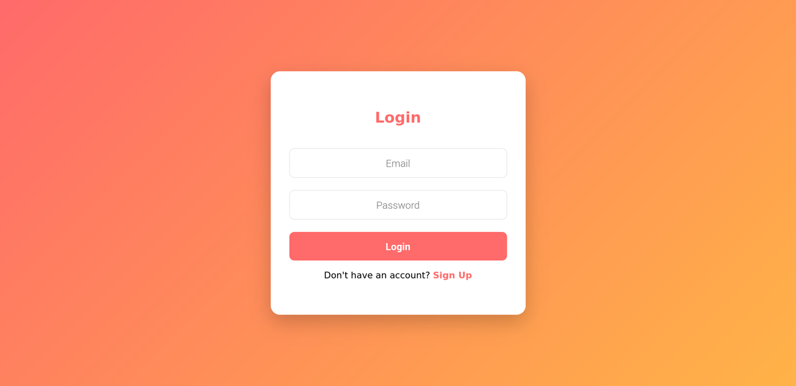<br><b>Login</b></td>
    <td align="center">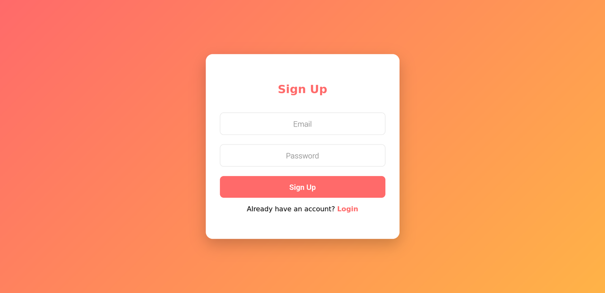<br><b>Sign Up</b></td>
  </tr>
  <tr>
    <td align="center">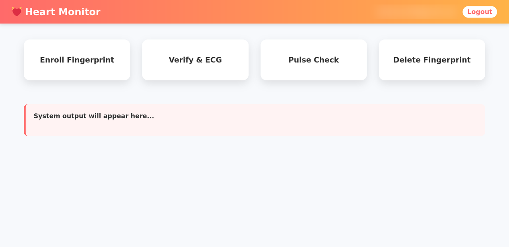<br><b>Dashboard</b></td>
    <td align="center">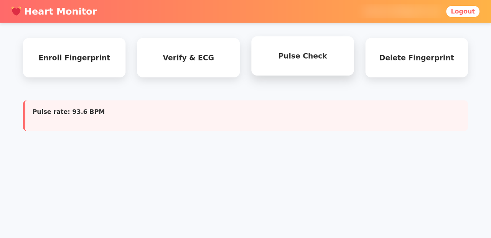<br><b>Pulse check result</b></td>
  </tr>
  <tr>
    <td colspan="2" align="center">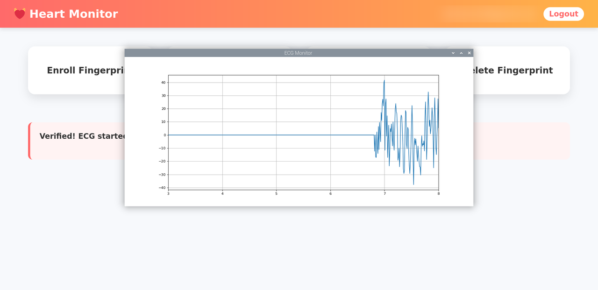<br><b>Live ECG monitor after fingerprint verification</b></td>
  </tr>
</table>

The dashboard has four action cards and a status box that displays the result of each command:

| Card | Action |
|---|---|
| **Enroll Fingerprint** | Registers a new fingerprint (two scans) |
| **Verify & ECG** | Verifies the fingerprint, then starts the live ECG |
| **Pulse Check** | Measures pulse rate for 10 seconds |
| **Delete Fingerprint** | Removes the fingerprint and the user's stored fingerprint record |

---

## 🚀 Installation & Setup

### 1. Prerequisites

- Raspberry Pi 4 running **Raspberry Pi OS** (the project was developed with Python 3.11), with a monitor attached, since the live ECG window uses Tkinter
- All hardware connected as described in the [wiring table](#wiring-as-configured-in-the-code)
- A Google account for Firebase

### 2. Enable the interfaces

```bash
sudo raspi-config
# Interface Options → SPI                → Enable
# Interface Options → Serial Port        → Login shell: No, Serial hardware: Yes
sudo reboot
```

### 3. Get the code

```bash
git clone https://github.com/ARShourov/Heart-Monitoring-System.git
```

### 4. Install dependencies

```bash
sudo apt update
sudo apt install -y python3-tk python3-numpy python3-scipy python3-matplotlib python3-venv

# Raspberry Pi OS Bookworm needs a virtual environment (reuse the apt packages above)
python3 -m venv --system-site-packages venv
source venv/bin/activate

pip install flask pyrebase4 pyserial spidev RPi.GPIO \
            adafruit-circuitpython-fingerprint RPLCD
```

### 5. Set up Firebase

1. Create a project in the [Firebase Console](https://console.firebase.google.com/).
2. **Authentication → Sign-in method →** enable **Email/Password**.
3. **Realtime Database →** create a database.
4. **Project settings → Your apps →** register a web app and copy its config.
5. Open `firebase_client.py` and replace the `firebase_config` values with **your own** project's config. Optionally change `DEVICE_ID`.
6. In `app.py`, replace `app.secret_key` with your own long random string.

> ⚠️ Never commit real API keys, secret keys or database rules that allow open access to a public repository. Use your own credentials locally and keep database rules restricted to authenticated users.

### 6. Run

```bash
python3 app.py
```

Open a browser on the Pi at `http://127.0.0.1:5000`, or from another device on the same network at `http://<raspberry-pi-ip>:5000`.

---

## 🕹️ How to Use

1. **Sign up** with an email and password, then **log in**.
2. Tap **Enroll Fingerprint** and place your finger when the LCD says *Enroll: 1st scan*. Lift it when asked, then place it again for the *2nd scan*.
3. Attach the ECG electrodes, then tap **Verify & ECG**. After the fingerprint is matched, a live ECG window opens and records for 30 seconds. A snapshot is saved to `ecg_images/` and the data is uploaded to Firebase.
4. Tap **Pulse Check**, rest your finger on the pulse sensor and stay still for 10 seconds. The BPM appears on the LCD and the dashboard.
5. Tap **Delete Fingerprint** to remove your fingerprint template and the related record from the cloud.
6. Open the Firebase Realtime Database to see the stored readings.

---

## ⚙️ Challenges

| Challenge | Description |
|---|---|
| 📊 **Data accuracy** | Getting precise and consistent heart-rate data in real time |
| 🧩 **Component integration** | Connecting several hardware modules (ADC, fingerprint sensor, LCD, sensors) seamlessly |
| 🌐 **Website synchronization** | Keeping the web app and database updates smooth and timely |
| 🧠 **Real-time processing** | Fast data handling and decision-making on limited hardware |
| 🔐 **Data security** | Protecting patient health data during wireless transmission |

---

## 🔮 Future Scope

- 🧠 **AI-based analysis** to predict heart conditions before they become critical
- 🔔 **Threshold-based alerts** and instant notifications to a consultant doctor or caregiver
- 👨‍⚕️ **Doctor / caregiver portal** for remote viewing of patient data
- 🛡️ **Enhanced security** to protect sensitive health data over wireless networks
- 📱 **Mobile app** for on-the-go monitoring
- 🔋 **Battery-powered wearable** version

---

## 👥 Team

| Name | Contribution |
|---|---|
| **Md. Abdur Rahman Shourov** | Team Leader + Overall project Builder |
| **Mst. Sumaiya Tasnuva** | Hardware Assemble |
| **Md. Waliul Islam** | Hardware Assemble |

**Supervisor:** Mohammed Golam Sarwar Bhuyan, Professor & Dean, Faculty of ECE

**Institution:** Bangladesh Army University of Engineering & Technology (BAUET), Qadirabad Cantonment, Natore, Bangladesh


## ⚠️ Disclaimer

This is an **academic prototype** built for learning and research. It is **not a certified medical device** and must not be used for diagnosis or to make medical decisions. If you suspect a heart problem, contact a doctor or emergency services immediately.
